<p align="center">
  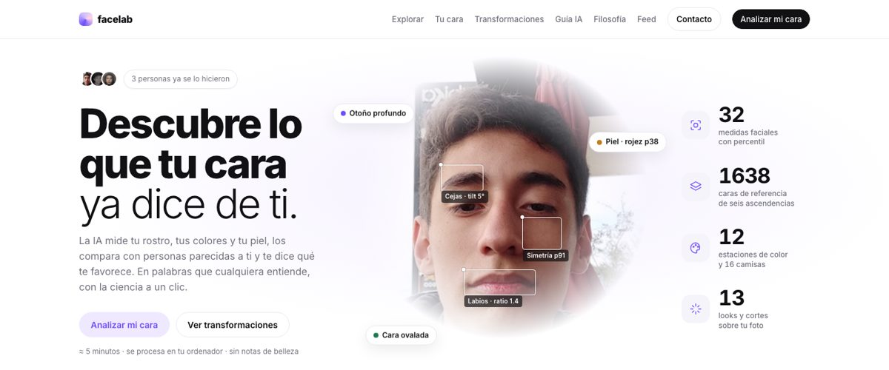
</p>

<h1 align="center">facelab</h1>

<p align="center">
  <b>Tu cara, medida y explicada.</b><br>
  Morfometría facial, colorimetría, piel, protocolo no quirúrgico y looks renderizados sobre tu propia foto.<br>
  Sin notas de belleza. Con la ciencia a un clic. Todo en tu ordenador.
</p>

<p align="center">
  <a href="https://github.com/Chere3/facelab/actions/workflows/ci.yml"></a>
  <a href="LICENSE"></a>
  
  
  
  
  
</p>

<p align="center">
  <a href="#-inicio-rápido">Inicio rápido</a> ·
  <a href="#-qué-hace">Qué hace</a> ·
  <a href="#-cómo-funciona">Cómo funciona</a> ·
  <a href="#-ciencia-y-fuentes">Ciencia</a> ·
  <a href="#-api-y-cli">API</a> ·
  <a href="docs/">Docs</a> ·
  <a href="#-contribuir">Contribuir</a>
</p>

---

## ¿Por qué existe?

Los servicios de "análisis facial" suelen dar una nota, un ranking y un vídeo motivacional. facelab hace lo contrario: **mide** 32 proporciones de tu cara con 478 puntos, las **compara con 1638 personas de tu mismo sexo y ascendencia**, lee tu **piel y tus colores**, y te lo cuenta en palabras que cualquiera entiende, con cada frase apoyada en un valor, un percentil y una norma citada. Después propone un **protocolo no quirúrgico** con evidencia y te enseña **cómo te verías** con él, con tu paleta de color y con 13 looks y cortes distintos, generados sobre tu propia foto.

Todo corre en tu Mac. Las fotos no salen de tu ordenador. El único texto que viaja es el que redacta la IA.

<p align="center">
  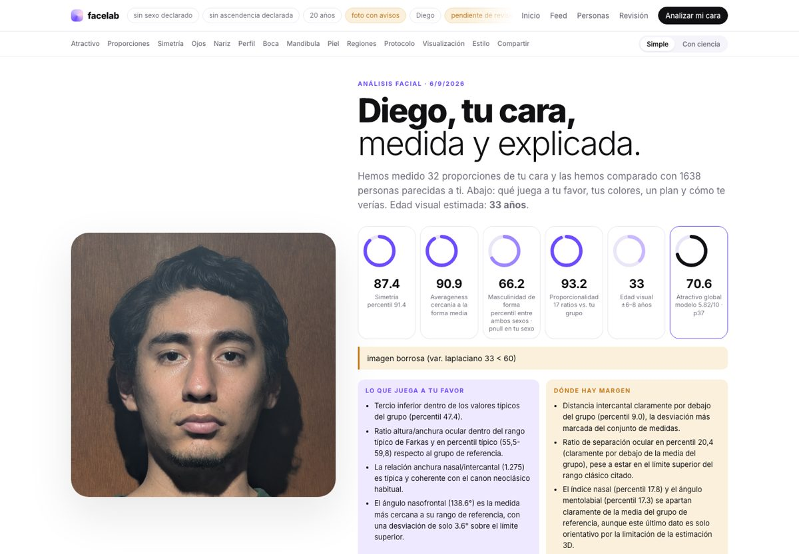
</p>

## ✨ Qué hace

| | Módulo | En una frase |
|---|---|---|
| 📐 | **Medidas antropométricas** | Tercios, quintos, índice facial, FWHR, tilt cantal, índice nasal, ratios de boca y labios, mandíbula, cejas, simetría. Con fórmula, unidad y norma citada. |
| 📊 | **Normas de tu grupo** | Cada medida con percentil frente a personas de tu sexo y ascendencia. Averageness, dimorfismo y proporcionalidad como scores explicados. |
| 🧴 | **Piel y edad visual** | Mapas de calor de rojez, manchas, textura y brillo con percentiles; edad visual con su margen de error. |
| 🎨 | **Colorimetría** | Piel, pelo e iris en CIELAB, 12 estaciones de color con ranking, paleta, metales, forma de cara y **la misma foto con 16 camisas** en menos de un segundo. |
| 👔 | **Estilo y looks** | Armario por categorías, seis looks (casual, smart casual, formal, urbano, **más femenino**, **más masculino**), cuatro cortes de pelo, barba o maquillaje. Cada uno renderizado sobre tu foto. |
| 🗺️ | **Protocolo por fases** | Entre 4 y 16 acciones no quirúrgicas de una biblioteca de 53 métodos con evidencia, coste, frecuencia y horizonte, según tres niveles: mantenimiento, mejora, glow-up. |
| 🔮 | **Proyección** | Cómo te verías a 3 y 12 meses siguiendo el protocolo, con una lista explícita de lo que no cambia (huesos, ojos, nariz, edad). |
| 📏 | **Perfil real** | Con una foto lateral: nasofrontal, nasolabial, mentolabial, convexidad y línea E medidos sobre la silueta real. |
| 🧑‍⚕️ | **Revisión humana** | Cola de revisión donde una persona corrige narrativa y protocolo, firma y aprueba. |
| 📱 | **Producto** | Onboarding de cinco pasos, feed con historias, informe en modo **Simple** (lenguaje llano y gráficas) o **Ciencia**, tarjetas 9:16 y PDF con portada. Front en Next.js + shadcn/ui. |

## 🚀 Inicio rápido

```bash
git clone https://github.com/Chere3/facelab && cd facelab
uv sync                      # API y pipeline (Python)
./dev.sh                     # arranca la API (:8766) y el front Next.js (:3000)
```

Abre **http://localhost:3000**, pulsa *Analizar mi cara*, sube una foto de frente y en cinco minutos tienes el informe completo. El preinforme con medidas y percentiles aparece en segundos; el resto se rellena solo. El informe tiene dos modos: **Simple** (para cualquiera, casi sin texto, con gráficas) y **Ciencia** (cada valor, percentil y norma).

Por separado: `uv run python -m facelab.serve` (API) y `cd web && bun install && bun run dev` (front).

<details>
<summary><b>Requisitos y qué hace falta para cada parte</b></summary>

| Parte | Necesita | Sin ello |
|---|---|---|
| Medidas, percentiles, piel, colorimetría, camisas, perfil, PDF | Python 3.11 + `uv` | — |
| Interfaz (portada, informe, feed, revisión) | [Bun](https://bun.sh) (Next.js 16, React 19, shadcn/ui, Recharts) | solo API |
| Narrativa, protocolo, asesoría de estilo | [Claude Code](https://claude.com/claude-code) con sesión iniciada (Agent SDK, sin API key) | esas secciones quedan pendientes |
| Proyección y looks | [Codex CLI](https://github.com/openai/codex) con `gpt-5.5` e `image_gen` | esas secciones quedan pendientes |
| PDF y tarjetas PNG | Google Chrome o Chromium | Imprimir → Guardar como PDF |

La primera ejecución descarga los modelos (MediaPipe, SegFormer, InsightFace, face-alignment), unos 1,5 GB. Apple Silicon corre todo en CPU sin configuración. Más en [docs/deploy.md](docs/deploy.md).
</details>

## 🖼️ Un paseo por el producto

<table>
<tr>
<td width="50%">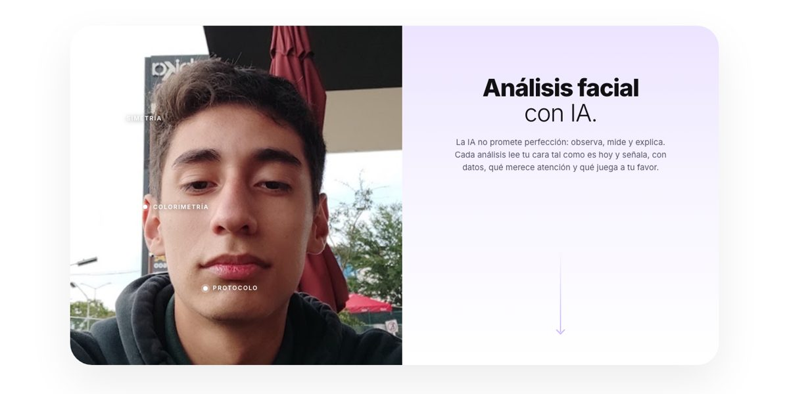</td>
<td width="50%">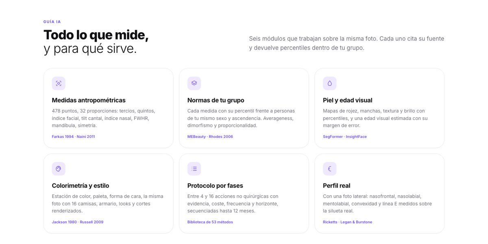</td>
</tr>
<tr>
<td><b>Portada.</b> Hero con la cara y marcadores de escaneo, prueba social real del feed, cómo funciona, manifiesto, transformaciones, guía, filosofía, planes y FAQ.</td>
<td><b>Guía.</b> Seis módulos, cada uno con su fuente. Nada se afirma sin cita.</td>
</tr>
<tr>
<td>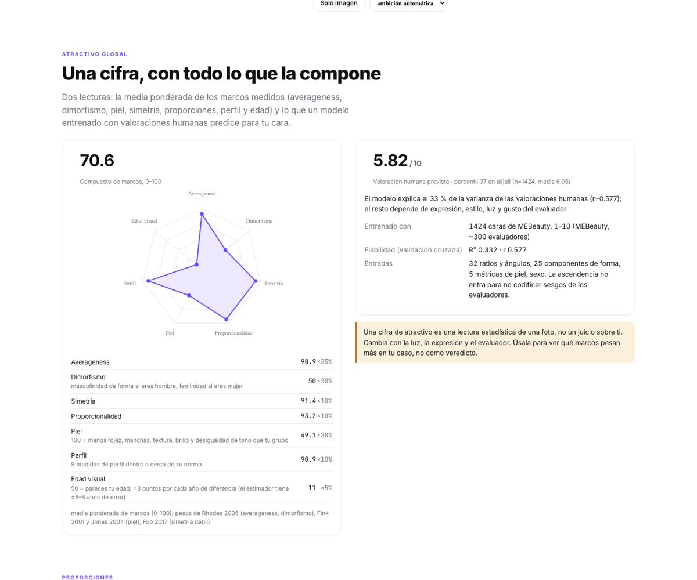</td>
<td>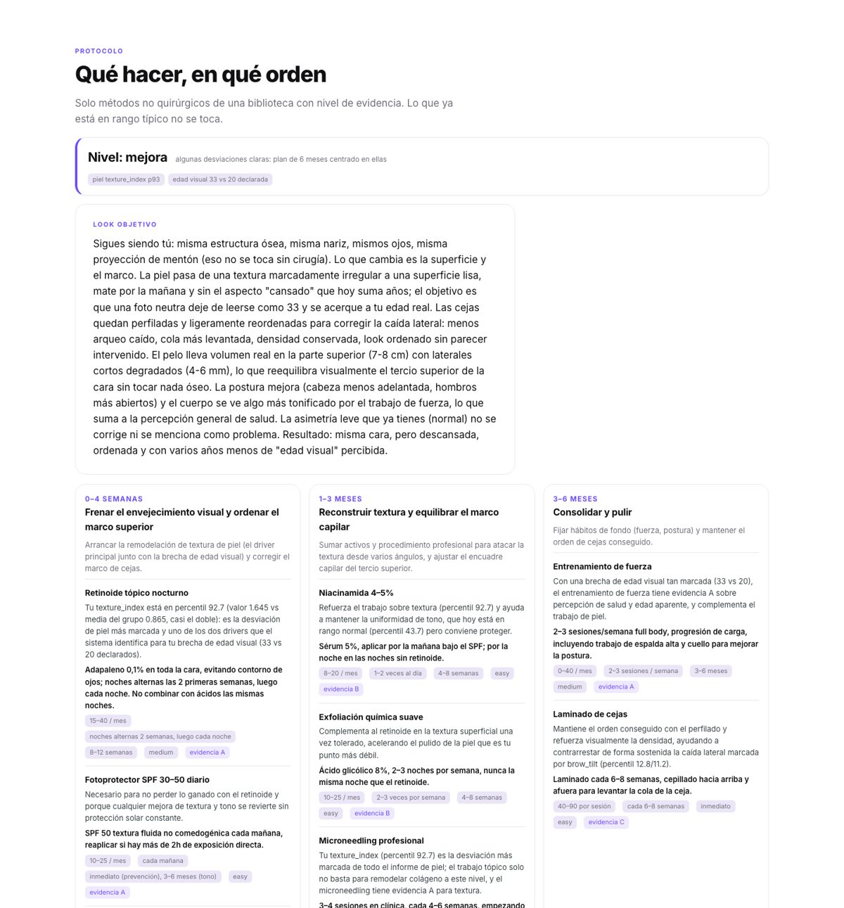</td>
</tr>
<tr>
<td><b>Lectura global.</b> Una cifra 0–100 con todos sus componentes y pesos, y un modelo estadístico con su fiabilidad declarada (R² 0,36). Se avisa de que es una lectura de una foto.</td>
<td><b>Protocolo.</b> Nivel de intensidad calculado, look objetivo, fases con acciones justificadas por medida y percentil, cambios esperados y carta del equipo.</td>
</tr>
<tr>
<td>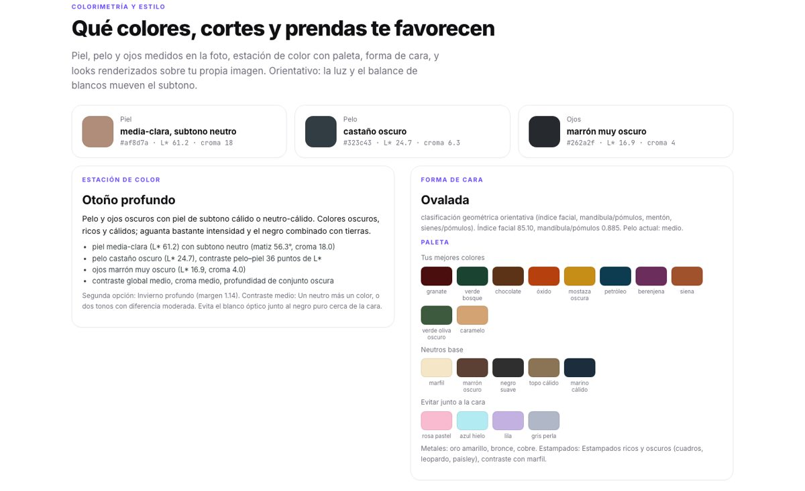</td>
<td>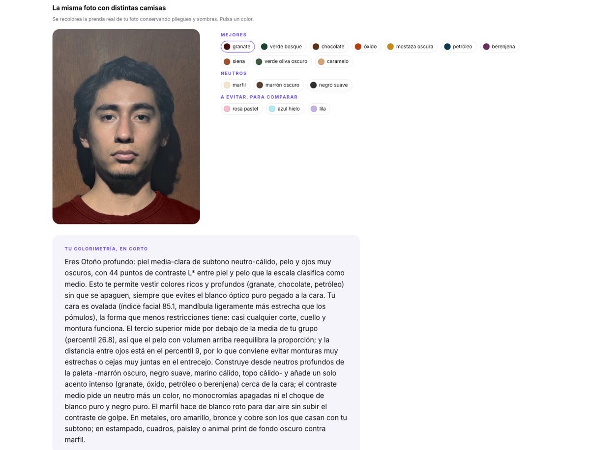</td>
</tr>
<tr>
<td><b>Colorimetría.</b> Piel, pelo y ojos medidos, estación de color con el porqué, forma de cara y paleta con neutros, metales y colores a evitar.</td>
<td><b>Camisas.</b> La prenda real de la foto recoloreada en LAB conservando pliegues y sombras. Pulsa un color y compara.</td>
</tr>
<tr>
<td>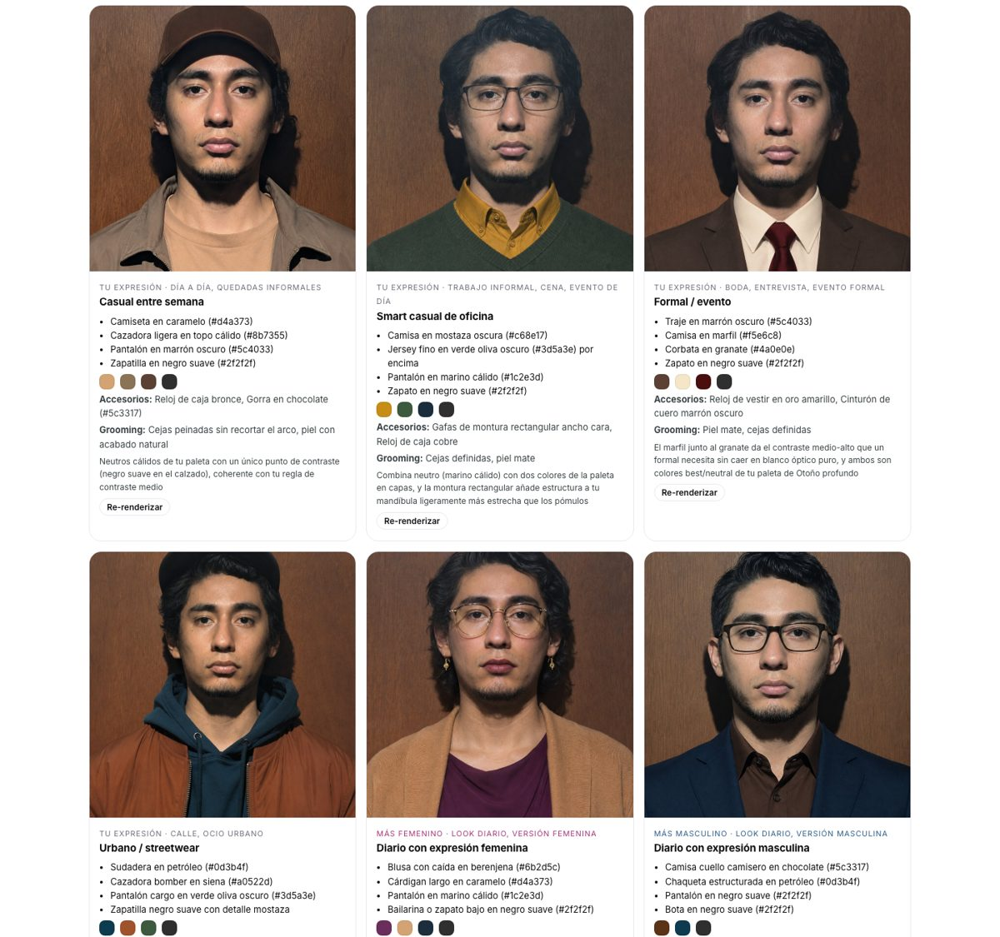</td>
<td>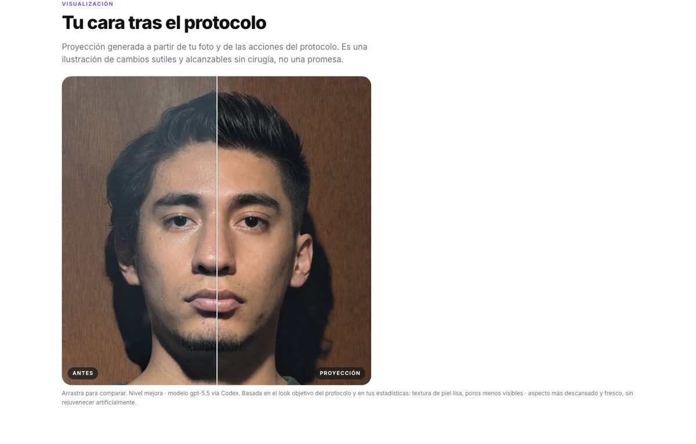</td>
</tr>
<tr>
<td><b>Looks.</b> Casual, smart casual, formal, urbano, más femenino y más masculino, con prendas, colores de la paleta, accesorios y grooming. Cada tarjeta se puede re-renderizar.</td>
<td><b>Proyección.</b> Antes y después con slider. Cambios alcanzables sin cirugía; la lista de lo que no debe cambiar va en el prompt.</td>
</tr>
</table>

<p align="center">
  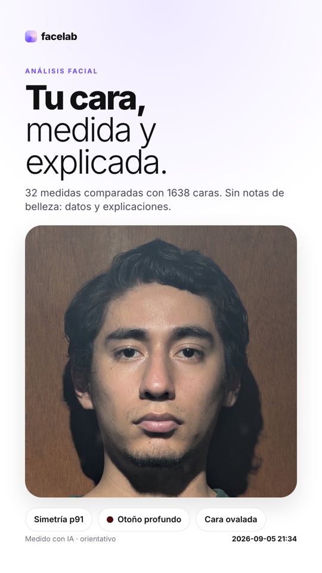
  &nbsp;&nbsp;
  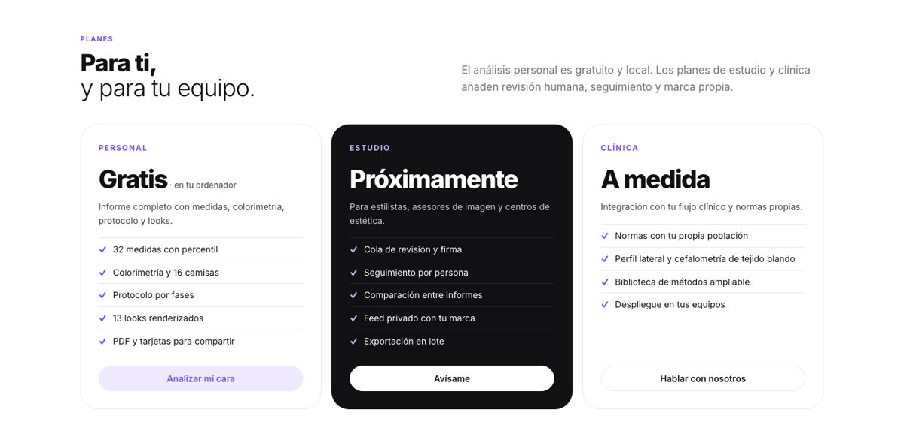
</p>

<p align="center"><i>Tarjetas verticales 1080×1920 listas para historias, y una portada pensada como producto: planes, contacto, FAQ.</i></p>

## 🔬 Cómo funciona

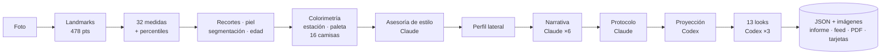

### 1. Landmarks y calidad de la foto

MediaPipe FaceLandmarker devuelve 478 puntos con iris y una matriz de pose. De ahí salen yaw, pitch y roll, y la varianza del laplaciano como nitidez. Si la pose se sale de ±12° el informe avisa. La imagen se alinea girándola hasta que la línea interpupilar es horizontal.

### 2. Medidas antropométricas

`points.py` mapea 30 puntos antropométricos clásicos (nasion, subnasale, exocantion, zygion, gonion, cheilion, pogonion…) a índices de la malla. `catalog.yaml` define cada medida con fórmula, unidad y norma citada, por ejemplo:

```yaml
- id: facial_index
  name: Índice facial morfológico
  formula: (nasion–menton) / bizigomática × 100
  unit: index
  norm: {hyperleptoprosopic: ">95", leptoprosopic: "90–95", mesoprosopic: "85–90", euryprosopic: "80–85"}
  source: Farkas 1994
```

Validación de repetibilidad en la FEI Face Database (50 sujetos × 3 fotos): 39 de 43 longitudes y ratios con CV < 3 %, ángulos con SD < 1,5°. Tabla completa en [docs/measures.md](docs/measures.md).

### 3. Normas empíricas y scores

1638 caras frontales de MEBeauty (6 ascendencias × 2 sexos) pasaron por el mismo pipeline. Cada medida se devuelve con percentil, media y z **dentro del grupo del usuario**. Sobre 25 componentes PCA de forma se calculan:

- **Averageness**: distancia a la forma media del grupo (Rhodes 2006).
- **Dimorfismo**: proyección sobre el eje forma media femenina → masculina de la ascendencia.
- **Proporcionalidad**: media de |z| en 17 ratios.
- **Simetría**: índice interno por pares de landmarks, con percentil.

La lectura global combina esos marcos con piel, perfil y edad visual usando pesos orientados por la literatura (Rhodes 2006, Fink 2001, Jones 2004, Foo 2017) y se acompaña de un modelo ridge entrenado con 1424 caras valoradas por ~300 personas, validación cruzada R² 0,36. **La ascendencia no entra como feature** para no codificar el sesgo de los evaluadores.

### 4. Piel, segmentación y edad

SegFormer (CelebAMask-HQ) separa piel, pelo, cejas, ojos, labios, orejas, cuello y ropa: de ahí sale la línea del pelo real y los tercios verdaderos. Los mapas de piel (rojez por a\* de LAB, manchas por oscurecimiento local, textura por desviación de paso alto, brillo especular) se calculan sobre una máscara derivada de la malla, para poder normarlos. InsightFace estima la edad visual con ±6–8 años de error, y el informe lo dice.

### 5. Colorimetría y estilo

Piel, pelo e iris se miden en CIELAB. El subtono sale del ángulo de matiz de la piel, la profundidad de L\*, el croma del iris y del contraste pelo–piel. Las 12 estaciones tienen coordenadas en esos tres ejes y se puntúa la cercanía: el informe muestra la primera, la segunda y el margen. La forma de cara sale del índice facial, la relación mandíbula/pómulos, la anchura del mentón y las sienes. `style.yaml` guarda las paletas, los cortes por forma de cara y expresión, monturas, cuellos y las palancas visuales de feminidad y masculinidad con sus fuentes (Russell 2009, Perrett 1998, Dixson & Brooks 2013, Jones 2015).

Con todo eso, Claude redacta la asesoría: armario, seis looks, cuatro cortes descritos como un peluquero, grooming, colores de pelo y qué evitar. Cada sugerencia trae un `render_prompt` que Codex ejecuta sobre la foto de busto, tres a la vez. Detalle en [docs/colorimetry.md](docs/colorimetry.md).

### 6. Narrativa, protocolo y proyección

Seis agentes en paralelo redactan las secciones en registro clínico: cada afirmación numérica se apoya en el dato, los percentiles se describen con rangos fijos y las medidas orientativas se marcan. `protocol.assess_intensity` cuenta desviaciones relevantes y asigna un nivel; Claude elige métodos de la biblioteca (53, con tier y evidencia), los secuencia en fases y escribe el look objetivo. La proyección se construye desde el look objetivo, las specs y los percentiles del sujeto, con una lista de lo que no debe cambiar. Biblioteca en [docs/methods.md](docs/methods.md).

### 7. Producto

Un JSON por informe, sin base de datos. El front es una app Next.js (`web/`) con shadcn/ui y Recharts que hace polling y rellena solo lo que cambia. Modo **Simple** (una idea por pantalla, anillos, radar, barras de percentil, frases en lenguaje llano) o **Ciencia** (cada valor, percentil, norma y fuente). Sección *Para compartir* con seis tarjetas 9:16 y descarga PNG. PDF A4 con portada. Feed con rejilla e historias. Cola de revisión humana. Arquitectura completa en [docs/architecture.md](docs/architecture.md).

## 📚 Ciencia y fuentes

| Tema | Fuentes |
|---|---|
| Antropometría facial | Farkas 1994 *Anthropometry of the Head and Face*; Naini 2011 *Facial Aesthetics* |
| Cefalometría de tejido blando | Ricketts (línea E); Legan & Burstone 1980; Powell & Humphreys 1984; Goode |
| Averageness, simetría, dimorfismo | Rhodes 2006 *Annu. Rev. Psychol.*; Perrett et al. 1998 *Nature*; Fink & Penton-Voak 2002 |
| Piel y atractivo | Fink, Grammer & Thornhill 2001; Jones et al. 2004; Foo, Simmons & Rhodes 2017 |
| Contraste facial y maquillaje | Russell 2009 *Perception*; Jones, Russell & Ward 2015 *Vision Research* |
| Barba | Dixson & Brooks 2013 *Evolution and Human Behavior* |
| Análisis de color | Jackson 1980 *Color Me Beautiful*; sistema de 12 estaciones |
| Dataset de normas | MEBeauty (Lebedeva et al. 2021), 1638 caras, ~300 evaluadores |
| Validación | FEI Face Database (Centro Universitário FEI), 50 sujetos × 14 poses |

Si un dato es orientativo (por ejemplo, los ángulos sagitales estimados desde la profundidad de MediaPipe sin foto de perfil), el JSON lleva `caveat` y la narrativa lo dice.

## 🧩 API y CLI

```bash
# subir una foto por API
curl -F file=@foto.jpg -F sex=female -F ancestry=asian -F age=28 -F person=Ana http://localhost:8766/analyze
# → {"stem": "foto_1788665699", "report_url": "/report/foto_1788665699"}

# estado y JSON del informe
curl http://localhost:8766/api/status/foto_1788665699
curl http://localhost:8766/api/report/foto_1788665699 | jq .style.season

# regenerar solo la colorimetría, o renderizar una tarjeta concreta
curl -X POST -H 'Content-Type: application/json' -d '{"steps":["style"]}' http://localhost:8766/api/regen/foto_1788665699
curl -X POST -H 'Content-Type: application/json' -d '{"steps":["looks"],"look_ids":["corte_3"]}' http://localhost:8766/api/regen/foto_1788665699

# PDF y tarjeta PNG
curl -o informe.pdf http://localhost:8766/api/pdf/foto_1788665699
curl -o tarjeta.png http://localhost:8766/api/card/foto_1788665699/2
```

```bash
# línea de comandos, sin servidor
uv run python -m facelab analyze foto.jpg --sex male --ancestry hispanic --age 25 --narrate --protocol -o out/foto.json
uv run python -m facelab.repeat samples/fei out/fei_repeat.json      # repetibilidad
uv run python -m facelab.build_norms samples/mebeauty norms/mebeauty_features.jsonl
```

Referencia completa en [docs/api.md](docs/api.md) y estructura del JSON en [docs/report-json.md](docs/report-json.md).

## 🗂️ Estructura del repositorio

```
facelab/
├── landmarks.py · points.py · geometry.py · measures.py · catalog.yaml   # medidas
├── norms.py · shape.py · attractiveness.py                                # normas y scores
├── crops.py · parsing.py · age.py · skin.py                               # visual
├── colorimetry.py · style.py · style.yaml                                 # colorimetría y estilo
├── profile_view.py                                                        # perfil lateral
├── narrate.py · protocol.py · methods.yaml · visualize.py                 # Claude y Codex
└── pipeline.py · serve.py                                                 # orquestación y API
web/        front Next.js: src/app (páginas), src/components (report, charts, landing, story, ui), src/lib (tipos, API, lenguaje llano)
norms/      features de MEBeauty y modelo de atractivo (se versionan)
docs/       arquitectura, API, medidas, métodos, colorimetría, despliegue
tests/      tests ligeros sin modelos
samples/ out/   fotos y resultados (ignorados por git: contienen caras)
```

## 🔐 Privacidad

- Las fotos y los informes se procesan y se guardan en el ordenador donde corre facelab.
- Solo sale de él el texto que redacta Claude y la foto de busto que edita Codex.
- El feed es opcional: cada persona elige si aparece.
- El servidor no tiene autenticación. Si lo expones (Tailscale, ngrok), lee [SECURITY.md](SECURITY.md).

## 🗺️ Roadmap

- [ ] Normas empíricas para las medidas de perfil (hace falta un dataset lateral etiquetado)
- [ ] Gonion y ángulo submental con mejor detección de cuello
- [ ] Normas por edad, no solo por sexo y ascendencia
- [ ] Seguimiento con fotos periódicas y deltas de piel
- [ ] Autenticación opcional para instalaciones compartidas
- [ ] Empaquetado como app de escritorio

## 🤝 Contribuir

Medidas nuevas con fuente, métodos con evidencia, mejoras de producto. Lee [CONTRIBUTING.md](CONTRIBUTING.md) y el [Código de conducta](CODE_OF_CONDUCT.md). Regla de oro: **nunca subas fotos de personas reales**.

```bash
uv run pytest -q             # tests
uv run ruff check facelab    # lint
cd web && bun run lint && bun run build   # front
```

## ⚖️ Licencia y aviso

MIT. facelab no presta servicios clínicos ni médicos. Las medidas son geométricas sobre una foto; los percentiles comparan con caras de un dataset público, no con una norma clínica. Cualquier procedimiento o principio activo del protocolo se consulta con un profesional. La asimetría leve es normal y no se corrige.

<p align="center"><sub>Hecho en un Mac, con MediaPipe, SegFormer, InsightFace, face-alignment, Claude y Codex.</sub></p>
