# Arquitectura

facelab es un servidor FastAPI local que convierte una foto en un informe JSON progresivo y lo pinta con páginas HTML sin framework. Todo el estado es un directorio de archivos por informe.

## Vista general

```mermaid
flowchart LR
  U[Foto frontal + perfil opcional] --> A[analysis<br/>MediaPipe 478 pts<br/>32 medidas + percentiles]
  A --> V[visual<br/>recortes · SegFormer · InsightFace · piel]
  V --> S[style<br/>colorimetría · forma de cara · 16 camisas<br/>asesoría Claude]
  S --> P[profile<br/>face-alignment + silueta<br/>ángulos sagitales reales]
  P --> N[narrative<br/>6 secciones Claude en paralelo]
  N --> PR[protocol<br/>intensidad + 53 métodos · Claude]
  PR --> VZ[visualize<br/>Codex image_gen 3 m / 12 m]
  VZ --> L[looks<br/>13 renders Codex, 3 en paralelo]
  L --> R[(out/mine/stem.json<br/>+ status.json + imágenes)]
  R --> W[report_page · feed · story · PDF]
```

Cada paso escribe en `out/mine/<stem>.json` y actualiza `out/mine/<stem>.status.json`. La página del informe hace polling cada 2,5 s y rellena solo lo que cambió (huella por sección), así que el usuario ve el preinforme en segundos y el resto va apareciendo.

## Módulos

| Módulo | Qué hace | Modelos / servicios |
|---|---|---|
| `landmarks.py` | 478 puntos con iris y matriz de pose (yaw, pitch, roll); calidad de foto (nitidez) | MediaPipe FaceLandmarker |
| `points.py` | Mapa de puntos antropométricos (nasion, subnasale, zygion, gonion…) a índices de la malla | — |
| `geometry.py` | Alineación por roll, distancias, ángulos, índice de simetría | — |
| `measures.py` + `catalog.yaml` | 32 medidas con fórmula, unidad y norma citada | — |
| `norms.py` | Percentiles por grupo (sexo × ascendencia) sobre 1638 caras; averageness, dimorfismo, proporcionalidad | features de MEBeauty |
| `shape.py` | PCA de forma (25 componentes) para averageness y eje de dimorfismo | — |
| `attractiveness.py` | Compuesto ponderado 0–100 y modelo ridge (R² 0,36) con radar por marcos | — |
| `crops.py` | Cara alineada, malla, guías, zonas anotadas, espejos | — |
| `parsing.py` | Segmentación (piel, pelo, ojos, orejas, cuello, ropa); línea del pelo real | SegFormer face-parsing |
| `age.py` | Edad visual con margen ±6–8 años | InsightFace buffalo_l (CPU) |
| `skin.py` | Mapas de rojez, manchas, textura y brillo; percentiles | — |
| `colorimetry.py` + `style.yaml` | Piel, pelo, iris en LAB; 12 estaciones; forma de cara; recolor de la prenda real | SegFormer |
| `style.py` | Asesoría de estilo (armario, 6 looks, 4 cortes, grooming) y renders | Claude Agent SDK, Codex CLI |
| `profile_view.py` | Silueta lateral y puntos cefalométricos de tejido blando | face-alignment 2D, SegFormer |
| `narrate.py` | Seis secciones clínicas en paralelo | Claude Agent SDK |
| `protocol.py` + `methods.yaml` | Nivel de intensidad, plan por fases, look objetivo, cambios esperados | Claude Agent SDK |
| `visualize.py` | Prompt desde estadísticas y protocolo; proyección 3 y 12 meses | Codex `image_gen` |
| `pipeline.py` | Orquestación por pasos con estado y regeneración parcial | — |
| `serve.py` | API, subida, feed, regeneración, PDF y tarjetas | FastAPI, Chrome headless |
| `ui.py`, `landing_page.py`, `feed_page.py`, `report_page.py`, `admin_page.py` | Sistema de diseño y páginas | — |

## Decisiones de diseño

**Un JSON por informe, sin base de datos.** Cada informe es autocontenido (`<stem>.json`, `<stem>.meta.json`, `<stem>.status.json` e imágenes con el mismo prefijo). Copiar, borrar o revisar un informe es mover archivos. El feed, la lista de personas y la comparación se calculan leyendo el directorio.

**Percentiles, no notas.** Todo lo que se compara se devuelve como percentil dentro del grupo de referencia del usuario. Los píxeles nunca se comparan entre personas. Las medidas orientativas (las que dependen de la z de MediaPipe) llevan `caveat` y la narrativa lo dice.

**Claude sin API key.** Narrativa, protocolo y asesoría usan el Agent SDK con la sesión de Claude Code de la máquina. Si falla o hay límite de uso, la regeneración conserva la versión anterior y el informe muestra el motivo.

**Codex para imágenes.** Las proyecciones y los looks llaman a `codex exec -m gpt-5.5 -i cara.jpg` con la herramienta `image_gen`. Cada prompt lleva una lista explícita de lo que no debe cambiar (identidad, huesos, ojos, nariz, edad). Los PNG se convierten a JPEG de 720 px para el informe y el PDF.

**Páginas sin build.** Todo el front es HTML y JS plano dentro de cadenas Python con un sistema de tokens compartido (`ui.py`). No hay bundler ni Node en tiempo de ejecución; Node solo se usa en desarrollo para `node --check`.

## Ciclo de vida de un informe

1. `POST /analyze` guarda la foto en `samples/mine/<stem>.jpg`, escribe `meta.json` y lanza `pipeline.run_full` en un hilo.
2. El navegador redirige a `/report/<stem>`, que consulta `/api/status/<stem>` y `/api/report/<stem>` cada 2,5 s.
3. Cada paso guarda el JSON con escritura atómica (`.json.tmp` → `rename`) para que la lectura nunca vea un archivo a medias.
4. `POST /api/regen/<stem>` con `{"steps": [...]}` relanza pasos concretos; con `look_ids` renderiza una sola tarjeta.
5. `PUT /api/review/<stem>` guarda ediciones humanas y marca el informe como revisado.
6. `GET /api/pdf/<stem>` abre `?print=1` en Chrome headless; `GET /api/card/<stem>/<n>` captura `/story/<stem>?card=n` a 1080×1920.

## Rendimiento (Apple M4, CPU)

| Paso | Tiempo |
|---|---|
| Landmarks + medidas | ~1 s |
| Recortes, segmentación, edad, piel | ~6 s |
| Colorimetría + 16 camisas | ~8 s |
| Asesoría de estilo (Claude) | ~60 s |
| Perfil lateral | ~15 s |
| Narrativa (6 secciones en paralelo) | ~60 s |
| Protocolo | ~60 s |
| Proyección (1–2 imágenes) | 1,5–3 min |
| 13 looks (3 en paralelo) | ~5,5 min |
| PDF | ~9 s |
